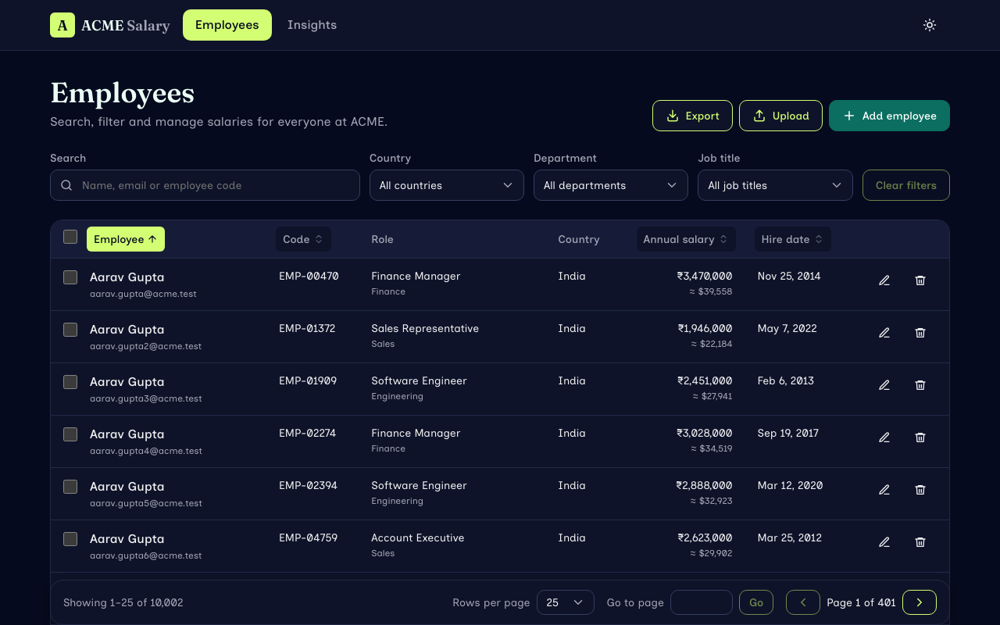
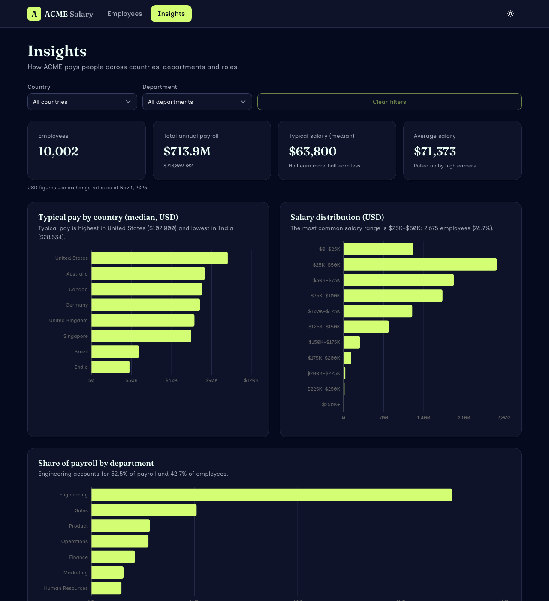
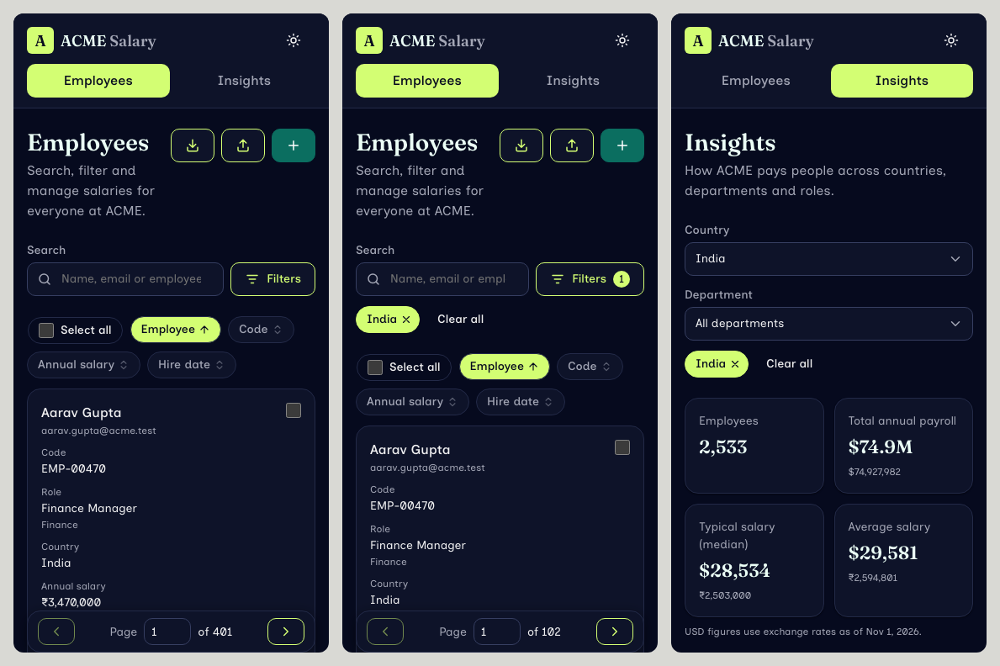

# ACME Salary Management

A web app for ACME's HR Manager to **manage the salaries of 10,000 employees across countries**
and **understand how the organization pays people**, replacing spreadsheets.

**Live app:** https://incubyte-ydik.vercel.app (seeded with 10,000 sample employees; no login)



## What it does

**Manage employees**
- Search by name, email or employee code; filter by country, department and job title; sort by any
  column. Everything runs in the database, 25–100 rows per page, and the URL keeps the state (shareable links).
- Add, edit and delete. **Employee codes are assigned automatically** (EMP-00042, never reused) and the
  **currency follows the country**.
- **Add a new country** from the Add employee form: pick from a world list and enter an exchange rate only
  when the currency is new.
- **Bulk delete**: tick rows across pages and searches, confirm once.
- **Bulk upload** from Excel or CSV: download the template, upload, see *"148 rows ready: 120 new, 28 updates"*
  or every problem as *Row 42 · Annual salary: …*, then save **all rows or none**.
- **Export** the filtered list to Excel or CSV. It has the same columns as the upload, so a file can be edited
  and uploaded back.

**Understand pay** (Insights page, filterable by country and department)
- Headcount, total payroll, typical (median) and average salary, in USD and in local currency.
- Typical pay by country, salary distribution, share of payroll by department, pay by job title.
- Each chart has a one-line takeaway, e.g. *"Typical pay is highest in United States ($102,000) and lowest in India"*.

**Works everywhere**: desktop, tablet and phone layouts, light and dark mode, keyboard and screen-reader friendly.

| Insights | Phone |
|----------|-------|
|  |  |

## Artifacts (read these first)

| Doc | What's inside |
|-----|---------------|
| [Requirements](docs/01-requirements.md) | Goal, scope, features, what's left out and why |
| [Architecture](docs/02-architecture.md) | Diagrams, layers, data model, API, testing strategy |
| [Decisions & trade-offs](docs/03-decisions.md) | Every key choice with alternatives, plus roadmap |
| [Build plan](docs/04-plan.md) | Step-by-step plan matching the commit history |
| [Performance](docs/05-performance.md) | Measured query times, query plans, known bottlenecks |
| [AI usage](docs/06-ai-usage.md) | How AI tools were used, the prompts given, and my own review findings |
| [CLAUDE.md](CLAUDE.md) | Engineering standards given to the AI agent (loaded in every session) |

## Run it locally

Requires **Node.js 22+** (see `.nvmrc`).

```bash
npm install
npm run seed       # creates server/local.db with 10,000 employees (same data every run)
npm run dev:api    # API on http://localhost:3001
npm run dev:web    # app on http://localhost:5173 (in a second terminal)
```

No environment variables are needed locally. To start again from clean data, run `npm run seed`.

## Quality checks

```bash
npm test           # all tests: shared rules, API (real SQLite in memory), web (React Testing Library)
npm run typecheck  # strict TypeScript
npm run lint       # ESLint
npm run format:check
npm run bench      # times the main queries and shows their query plans (read-only; seed first)
```

## Project structure

```
shared/   Zod schemas and types used by both sides (one set of validation rules)
server/   Express API: features/<feature>/ routes → service → repository; db/ schema, migrations, seed
web/      React app: features/<feature>/ pages, dialogs, hooks; components/ shared UI; theme/ design tokens
docs/     The artifacts above
```

## Deployment

One Vercel project serves both parts on the same domain:
the React app as static files and the Express API as a single serverless function.
The database is [Turso](https://turso.tech) (hosted SQLite, the same SQL as local development).

`npm run build:vercel` writes Vercel's [Build Output](https://vercel.com/docs/build-output-api/v3)
format directly (`.vercel/output`): the web build plus the API bundled into one file with esbuild.
Vercel runs this command automatically (see `vercel.json`). The build also loads the bundled function
on its own, so a missing dependency fails the build instead of the live site.

**Set up once**

1. Create a Turso database and an auth token.
2. Seed it from your machine:
   `DATABASE_URL=libsql://… DATABASE_AUTH_TOKEN=… npm run seed`
3. Import the GitHub repo in Vercel and add the environment variables `DATABASE_URL` and
   `DATABASE_AUTH_TOKEN` (see `.env.example`).

Every push to `main` then deploys automatically. Database changes (new tables) are applied on start-up.

## Tech stack

TypeScript · Node.js · Express · SQLite (libSQL / Turso) · Zod · React · Vite · Styled Components ·
TanStack Query · React Hook Form · Recharts · SheetJS (Excel/CSV) · Vitest · MSW · Vercel
