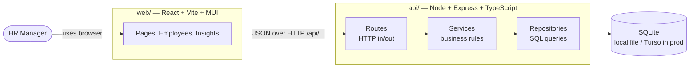
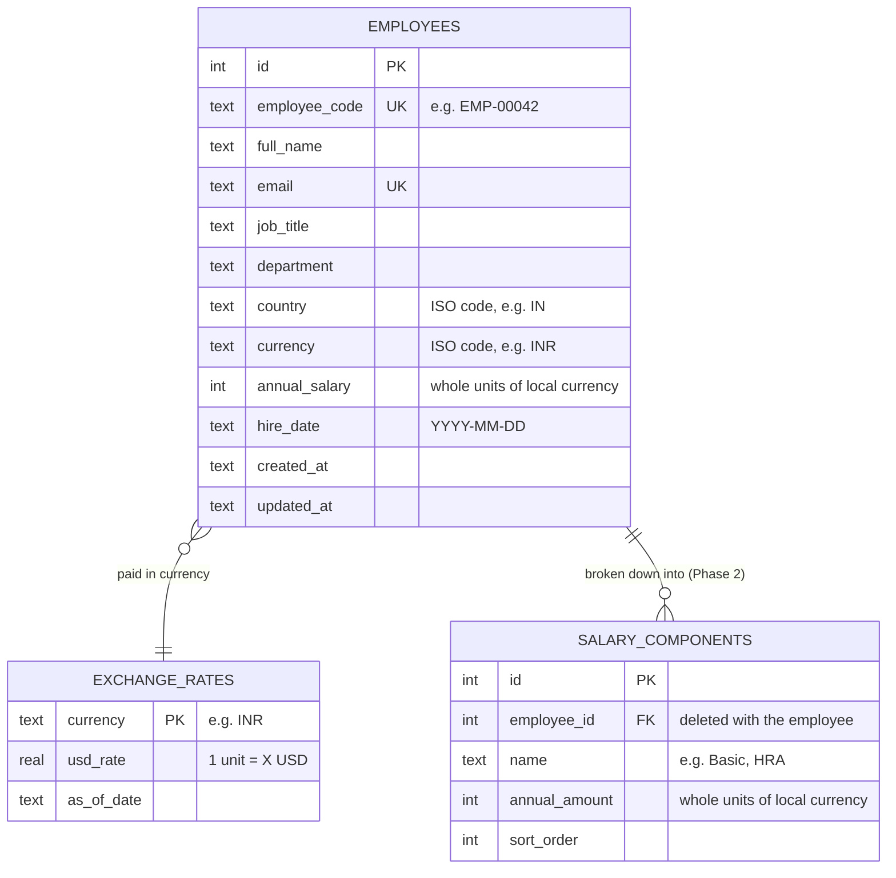

# Architecture & Design

## 1. Big picture



In plain words:

- **web/** — what the HR Manager sees and clicks.
- **api/** — receives requests, checks the data, applies rules, talks to the database.
- **Database** — stores employees and exchange rates.

## 2. Backend layers (why 3 layers?)

| Layer | Job | Knows about HTTP? | Knows about SQL? |
|-------|-----|-------------------|------------------|
| **Routes** | Read request, validate input, send response | Yes | No |
| **Services** | Business rules (currency conversion, statistics) | No | No |
| **Repositories** | Run SQL queries | No | Yes |

Each layer only talks to the one below it. This keeps business logic **easy to unit test**
(no server, no database needed) and makes each file small and focused.

## 3. Folder structure

```
/
├── api/                    Backend
│   ├── src/
│   │   ├── employees/      routes, service, repository, schema (one folder per feature)
│   │   ├── insights/       routes, service, repository
│   │   ├── import-export/  file parsing, row validation, export (Phase 2)
│   │   ├── db/             connection, migrations, seed
│   │   └── app.ts          Express app (exported for tests)
│   └── test/
├── web/                    Frontend
│   └── src/
│       ├── pages/          EmployeesPage, InsightsPage
│       ├── components/     EmployeeTable, EmployeeForm, charts...
│       └── api/            small typed API client
└── docs/                   These artifacts
```

Code is grouped **by feature** (employees, insights), not by type, so everything about one feature lives together.

## 4. Data model



- **Salary components (Phase 2)** are optional. If an employee has any, they must add up exactly to `annual_salary`.
  Only earnings are stored; deductions such as PF and TDS are out of scope.

- Salary stored as an **integer** (no floating-point rounding issues for money).
- Indexes on `country`, `department`, `job_title`, `(country, job_title)` and `annual_salary` for fast filters and insights.

## 5. API

| Method | Path | Purpose |
|--------|------|---------|
| GET | `/api/employees?page=&pageSize=&search=&country=&department=&jobTitle=&sortBy=&sortOrder=` | Paginated, filtered list |
| GET | `/api/employees/:id` | One employee |
| POST | `/api/employees` | Create |
| PUT | `/api/employees/:id` | Update |
| DELETE | `/api/employees/:id` | Delete |
| GET | `/api/insights/summary` | Headcount, total payroll, average, median (USD) |
| GET | `/api/insights/by-country` | Stats per country (local + USD) |
| GET | `/api/insights/by-job-title?country=` | Stats per job title, optionally in one country |
| GET | `/api/insights/by-department` | Headcount & payroll per department |
| GET | `/api/insights/distribution` | Count of employees per salary band (USD) |
| GET | `/api/meta` | Lists of countries, departments, job titles (for dropdowns) |
| **Phase 2** | | |
| GET | `/api/employees/import/template?format=xlsx\|csv` | Download an empty template with the right columns |
| POST | `/api/employees/import?dryRun=true` | Upload a file → validate only, return preview (rows to add / update) and row-level errors |
| POST | `/api/employees/import` | Upload a file → validate and save everything in **one transaction** (all or nothing) |
| GET | `/api/employees/export?format=xlsx\|csv&...filters` | Download the current filtered list |
| GET | `/api/employees/:id/components` | Salary breakdown of one employee |
| PUT | `/api/employees/:id/components` | Replace the whole breakdown (validated: amounts > 0, unique names, sum = annual salary) |

Errors use one consistent shape: `{ "error": { "message": "...", "details": [...] } }` with proper status codes (400, 404, 409, 500).

## 6. Tech stack

| Area | Choice |
|------|--------|
| Language | TypeScript everywhere |
| Backend | Node.js + Express |
| Database | SQLite via `@libsql/client` (local file in dev, in-memory in tests, Turso in production) |
| Validation | Zod (one schema = runtime check + TypeScript type) |
| Excel / CSV (Phase 2) | ExcelJS (reads & writes .xlsx and .csv), Multer (file upload) |
| Frontend | React + Vite |
| UI library | MUI (Material UI) + MUI X DataGrid & Charts |
| Data fetching | TanStack Query (caching, loading & error states) |
| Tests | Vitest, Supertest (API), React Testing Library (UI) |
| Deploy | Vercel (frontend + API) + Turso (hosted SQLite) |

Reasons for each choice are in [decisions & trade-offs](03-decisions.md).

## 7. Testing strategy

| Level | What | Tool | Speed |
|-------|------|------|-------|
| Unit | Services: validation, currency conversion, median/average, salary bands | Vitest | milliseconds, no DB |
| Integration | API endpoints against an **in-memory SQLite** DB with a small fixed dataset | Vitest + Supertest | fast, isolated per test |
| Component | Key UI pieces: employee form validation, table rendering, error states | React Testing Library | fast, API mocked |

All tests are **deterministic**: fixed test data, fixed seed for fake data, no network, no real clock.
