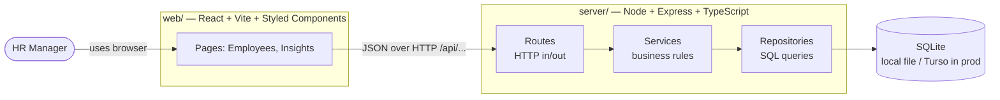
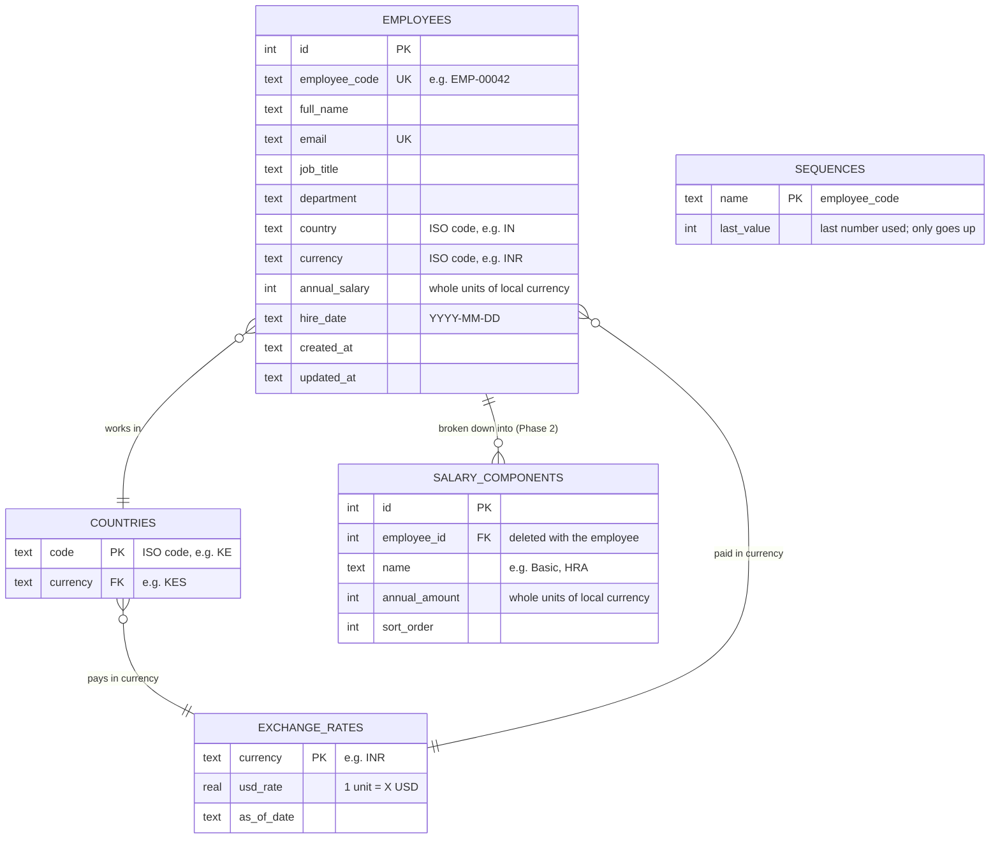

# Architecture & Design

## 1. Big picture



In plain words:

- **web/** — what the HR Manager sees and clicks.
- **server/** — the API: receives requests, checks the data, applies rules, talks to the database.
- **Database** — stores employees and exchange rates.

## 2. Backend layers (why 3 layers?)

| Layer | Job | Knows about HTTP? | Knows about SQL? |
|-------|-----|-------------------|------------------|
| **Routes** | Read request, validate input, send response | Yes | No |
| **Services** | Business rules (currency conversion, statistics) | No | No |
| **Repositories** | Run SQL queries | No | Yes |

Each layer only talks to the one below it. This keeps business logic **easy to unit test**
(no server, no database needed) and makes each file small and focused.

## 3. Folder structure

```
/
├── shared/                   Contracts used by BOTH server and web
│   └── src/                  Zod schemas (employee input, query params) + API response types
├── server/                   Backend (the API)
│   └── src/
│       ├── features/
│       │   ├── employees/    routes, service, repository, tests
│       │   ├── insights/     routes, service (stats math), repository (aggregation SQL)
│       │   ├── compensation/ salary components (Phase 2)
│       │   └── csv/          Excel/CSV import & export (Phase 2)
│       ├── db/               connection, schema/migrations, seed
│       ├── http/             error handler, validation middleware, error types
│       └── app.ts            Express app (exported for tests)
├── web/                      Frontend
│   └── src/
│       ├── app/              App entry, routing, providers (QueryClient, Theme)
│       ├── components/       Reusable UI: Button, Input, Select, Table, Pagination, Dialog, StatCard...
│       ├── features/
│       │   ├── employees/    list page, form, API hooks, filters
│       │   ├── dashboard/    insights page, charts, API hooks
│       │   ├── compensation/ salary breakdown editor (Phase 2)
│       │   └── csv/          import dialog, export button (Phase 2)
│       ├── services/         HTTP client (one place for fetch + error handling)
│       ├── theme/            design tokens (colors, spacing, typography...) + global styles
│       └── utils/            pure helpers (e.g. currency formatting)
└── docs/                     These artifacts
```

- Code is grouped **by feature**, so everything about employees lives in `features/employees/` on both sides.
- Folders are created only when they are needed — no empty placeholders.
- `shared/` exists because the **same validation rules** (e.g. "salary must be > 0") are needed in the API and in the form. One schema, no drift.

## Frontend state — where each kind of data lives

| Kind of state | Example | Where it lives |
|---------------|---------|----------------|
| Server state | employee list, insights | **TanStack Query** (cached, refetched after changes) |
| URL state | search, filters, sort, page | **URL query params** — shareable, survives refresh, back button works |
| Form state | add / edit employee | **React Hook Form** + Zod schema from `shared/` |
| Local UI state | dialog open/closed | `useState` |
| Global state | theme only | Styled Components `ThemeProvider` — no global store needed |

## 4. Data model



- **Countries** are data, not code: the seed sets up 8, HR adds more in the app. Only the code and currency are
  stored; names come from the built-in `Intl.DisplayNames`. Saving an employee checks the country is set up and
  copies its currency. Databases from before this table are backfilled from their employees on start-up.
- **Salary components (Phase 2)** are optional. If an employee has any, they must add up exactly to `annual_salary`.
  Only earnings are stored; deductions such as PF and TDS are out of scope.

- Salary stored as an **integer** (no floating-point rounding issues for money).
- Indexes on `(country, job_title)`, `department`, `job_title` and `annual_salary` for fast filters and insights.
  A separate `country` index is not needed: the `(country, job_title)` index already serves country-only lookups.
  The separate `job_title` index *is* needed: a two-column index only helps when the search starts with its
  **first** column, so filtering by job title alone (across all countries) would otherwise scan every row.
  Verified with `EXPLAIN QUERY PLAN`: `SEARCH ... USING INDEX idx_employees_job_title` vs. `SCAN employees USING ... idx_employees_country_job_title` (reads every entry) without it.
- Tables are **STRICT** (SQLite rejects wrong types instead of silently storing them), with `CHECK` rules
  (salary > 0, non-blank name), unique `employee_code` and case-insensitive unique `email`,
  and a foreign key from `currency` to `exchange_rates`.
- Schema statements are idempotent (`IF NOT EXISTS`) and run in one all-or-nothing batch on server start.
  A versioned migration tool would be added once the schema needs to change after go-live.

## 5. API

| Method | Path | Purpose |
|--------|------|---------|
| GET | `/api/employees?page=&pageSize=&search=&country=&department=&jobTitle=&sortBy=&sortOrder=` | Paginated, filtered list |
| GET | `/api/employees/:id` | One employee |
| POST | `/api/employees` | Create |
| PUT | `/api/employees/:id` | Update |
| DELETE | `/api/employees/:id` | Delete |
| POST | `/api/employees/bulk-delete` | Delete several: body `{ "ids": [1, 2, …] }` (1–500), one statement so all or nothing; returns `{ "deletedCount" }` (ids already gone are skipped) |
| GET | `/api/insights/summary` | Headcount, total payroll, min / median / average / max (USD), exchange-rate date |
| GET | `/api/insights/by-country` | Stats per country (local currency + USD) |
| GET | `/api/insights/by-job-title` | Stats per job title — across all countries, or in one with `?country=` |
| GET | `/api/insights/by-department` | Headcount, payroll and stats per department |
| GET | `/api/insights/distribution` | Headcount per $25k USD band (11 bands, last one is 250k+), empty bands included |
| GET | `/api/employees/filter-options` | Distinct countries (codes), departments and job titles that have employees (for filter dropdowns) |
| GET | `/api/countries` | Countries that are set up, A→Z, with their currency (for the Add employee form) |
| POST | `/api/countries` | Set up a country: `{ "code": "KE", "usdRate": 0.0077 }`; the rate is required only if no country uses that currency yet; 409 if already set up |
| **Phase 2** | | |
| GET | `/api/employees/import/template?format=xlsx\|csv` | Download an empty template with the right columns |
| POST | `/api/employees/import?dryRun=true` | Upload a file → validate only, return preview (rows to add / update) and row-level errors |
| POST | `/api/employees/import` | Upload a file → validate and save everything in **one transaction** (all or nothing) |
| GET | `/api/employees/export?format=xlsx\|csv&...filters` | Download the current filtered list |
| GET | `/api/employees/:id/components` | Salary breakdown of one employee |
| PUT | `/api/employees/:id/components` | Replace the whole breakdown (validated: amounts > 0, unique names, sum = annual salary) |

Errors use one consistent shape, with proper status codes (400, 404, 409, 500):

```json
{ "error": { "message": "Some of the values you sent are not valid.",
             "details": [{ "field": "pageSize", "message": "Too big: expected number to be <=100" }] } }
```

Unexpected errors are logged on the server; the client only gets a generic message (no stack traces or SQL).

**Write endpoint rules:** `POST` assigns the **next employee code** (EMP-xxxxx from the `sequences` counter, in the
same transaction as the insert; a code sent by the client is ignored) and returns **201** with a `Location` header;
`PUT` never changes the code; `PUT` replaces all fields; `DELETE` returns **204**;
unknown id → **404**; duplicate employee code or email → **409** naming the field. The body is validated with the
shared `employeeInputSchema` (same rules as the web form). Currency is derived from the country. Each write and the
read-back of the saved row run in one batch (one round trip, one transaction).

**Insights rules:** every insights endpoint accepts the same optional filters (`?country=&department=`), so all
dashboard numbers describe the same employees. All statistics are computed **in SQL** (one row per group comes back).
Each group has USD stats; `local` stats (in the local currency) are included only when everyone in the group is paid
in one currency — e.g. per country, or any grouping filtered to one country.

**List endpoint rules:** `pageSize` defaults to 25, max 100; `sortBy` must be one of `fullName`, `employeeCode`,
`annualSalary`, `hireDate` (whitelist → column map, never raw input in SQL); codes sort in number order
(by length, then text, so EMP-100000 comes after EMP-99999); ties are broken by `id` so pages are stable;
search matches name, email or code (case-insensitive, `%` and `_` treated literally); count and page are fetched in one
read batch (one round trip, consistent totals).

## 6. Tech stack

| Area | Choice |
|------|--------|
| Language | TypeScript everywhere |
| Backend | Node.js + Express |
| Database | SQLite via `@libsql/client` (local file in dev, in-memory in tests, Turso in production) |
| Validation | Zod (one schema = runtime check + TypeScript type) |
| Excel / CSV (Phase 2) | ExcelJS (reads & writes .xlsx and .csv), Multer (file upload) |
| Frontend | React + Vite |
| Styling & UI | Styled Components + a small in-house component set built on central design tokens |
| Routing | React Router |
| Data fetching | TanStack Query (caching, loading & error states) |
| Forms | React Hook Form + Zod resolver |
| Charts | Recharts |
| Tests | Vitest, Supertest (API), React Testing Library (UI) |
| Deploy | Vercel (frontend + API) + Turso (hosted SQLite) |

Reasons for each choice are in [decisions & trade-offs](03-decisions.md).

## 7. Testing strategy

| Level | What | Tool | Speed |
|-------|------|------|-------|
| Unit | Shared Zod schemas (validation & normalisation), seed generator | Vitest | milliseconds, no DB |
| Integration | API endpoints against an **in-memory SQLite** DB with a small fixed dataset — incl. insights maths (median, averages, bands) on 5 hand-checkable employees | Vitest + Supertest | fast, isolated per test |
| Component | Key UI pieces: employee form validation, table rendering, error states | React Testing Library | fast, API mocked |

All tests are **deterministic**: fixed test data, fixed seed for fake data, no network, no real clock.
